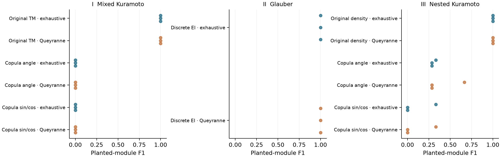

# 正文三个动力学例子：Queyranne 与 Gaussian copula 对照

2026-10-31。预定方案见 [协议](spt_queyranne_copula_protocol_2026-10-31.md)。按用户要求，Glauber 保留离散精确 EI，没有采用 Gaussian copula。本次没有修改正文或公共 SPT 实现。

## 结论

三个例子的原文信息读取方式下，Queyranne 与穷举搜索在每个实际访问的节点上达到相同最小目标；植入模块评分均为 1。一个离散 oracle 的对称并列产生了不同的原始二叉细分，但落在不评分的基本模块内部。搜索调用的不同非空 EI 子集从 63 次降到 43–45 次；6 个源时，已预计算信息表的纯搜索中 Queyranne 实际反而略慢，不能声称端到端加速。

两个连续 Kuramoto 系统上，Gaussian copula 计算明显更快，但没有稳定恢复原文植入的超边模块。原文方法保留对相同的动力学模型的对照；copula 只作为一种指定坐标及 ridge 的近似，不代表所有 copula 类方法。替换估计器会改变树与目标值，Queyranne 并不能修正估计器丢失的高阶信息。

图：横轴为原文的 module F1，点分别是三个种子或积分重复。I 为 3 次独立模型拟合；II 为 3 个原文 48,000 对样本 MLP 缓存；III 的 3 点是同一拟合模型下的 3 次积分随机化 / 独立干预样本，不是 3 个独立训练模型。原始角度与 sin/cos 两维源块的 copula 使用完全相同的对应样本；II 的精确模型 oracle 未画入，但同样 F1=1。没有把 F1 当作 EI 数值误差。

| 系统 | 信息读取 | 穷举 F1，3 次 | Queyranne F1，3 次 | 重复的性质 |
|---|---|---|---|---|
| I 混合阶 Kuramoto | 原文分量神经 TM | 1, 1, 1 | 1, 1, 1 | 3 次动力学数据与 MLP 拟合 |
| I 混合阶 Kuramoto | copula，原始角度 | 0, 0, 0 | 0, 0, 0 | 同一批拟合通道与干预响应 |
| I 混合阶 Kuramoto | copula，sin/cos 源块 | 0, 0, 0 | 0, 0, 0 | 与上行配对样本哈希一致 |
| II Glauber | 原文 MLP + 精确离散 EI | 1, 1, 1 | 1, 1, 1 | 3 个原 48,000 对 MLP 缓存 |
| III 嵌套 Kuramoto | 原文共享通道密度 | 1, 1, 1 | 1, 1, 1 | 单一拟合模型，3 个积分 scramble |
| III 嵌套 Kuramoto | copula，原始角度 | 0.333, 0.286, 0.286 | 0.667, 0.286, 0.286 | 同一模型，3 批干预响应 |
| III 嵌套 Kuramoto | copula，sin/cos 源块 | 0.333, 0, 0 | 0.333, 0, 0 | 与上行配对样本哈希一致 |

III 里 Queyranne 的 0.667 与穷举的 0.333 不代表 Queyranne 找到更优的同一目标：该实例存在估计误差导致的次模违反，Queyranne 所选某节点目标**比穷举最优大 0.0007334 nats**，偶然得到了更符合植入结构的树。对同一估计目标，穷举是节点真实最优。相反，在 I 的 copula seed 2，最大节点目标差约 0.00000536 nats，两个算法虽然 F1 均为零，具体树不同。

## 模型、参考与范围

- I：按原文模型重新生成 4,800 条训练转移并拟合 48/48 SiLU MLP（800 epochs），以完整 held-out 残差协方差及 4,000 个独立均匀相位干预生成共同响应，目标是六维 wrapped phase increment。原文神经 TM 路径使用 MLP permutation effect、0.25 SD 阈值构造组件，100 epochs、512 个积分点、256 个边缘补全点。三次均识别到 `{1,2,3}` 与 `{4,5,6}` 两组件；原文组件近似令它们在读取模型中分解，尽管物理系统保留弱跨模块耦合，因此该分解是方法假设的一部分。copula 在同一拟合 MLP、同一批干预响应上拟合，不强加此组件分解。
- II：读取原文 48,000 对转移的 MLP 缓存 seed 1–3，子集 EI 由拟合的完整 64 状态离散联合通道精确计算。另用原动力学的 64×64 矩阵指数得到的 oracle 通道重算，精确 EI 下两个搜索也恢复 1.0。Oracle 原始二叉树在 `{4,5,6}` 内出现并列细分差异；该内部细分不计入 planted-module F1。
- III：复用原文弱桥接 `results/spt_third_case_weak_coupling/model.json`，保持完整六维 unwrapped future phase 为目标。原文共享条件密度信息表复用原先 `N4096/P512`、scramble 880/1880/2880 缓存；同一 MLP 下另取三批 4,096 个独立相位干预、Gaussian 残余生成 copula 样本。这两种读取使用相同拟合通道和干预分布，但**不是同一批积分点**；因此 EI 值差异同时可能包含估计误差和 Monte Carlo 差异。
- Gaussian copula 的基础设置：对每个源角度、各目标分量以秩 Gaussian 化，构造单一 joint 协方差加 1e−6 的对角 ridge，从其边缘计算全部 63 个 EI，单位 nats。周期敏感性用每源 `(sin θ, cos θ)` 作为不拆开的二维源块，其他参数、目标和配对样本相同；实验哈希逐项核对。秩变换和 Gaussian 密度假设为显式近似，尤其周期变量不等同于自然欧氏坐标。

原文整体 Fig.1d 的已存单棵树与这些重复并非同一层次的证据：本次 I 为新训练，II 重用确认缓存，III 重用一个模型。三次重复不足以支持跨模型的普遍稳定或统计显著性。若比较真实物理系统，MLP 拟合误差和 I 的组件近似都需考虑。

## 非负性、次模与搜索审计

每个非空父集合的所有非平凡二分，共检查 301 个 Syn；对每个父集合检查 1,215 个次模基本不等式。原始数值保留，不截零。I 按原文的 0.1 bit，即 **0.0693147 nats** 作为非负容差；II 用 1e−10 bit，即 **6.93147e−11 nats**；III 用 **0.01 nats**。容差不是负 Syn 证据。全 16 项主结果的负值低于容差数量为 0；树闭合误差最大 2.22e−15 nats。独立附加的 6 个 sin/cos copula 设置也无超容差 Syn。

Gaussian copula 存在数量不少的容差内负残差：I 的 3 次分别为 99、95、196 个，最小分别 −0.0000223、−0.0000360、−0.0000354 nats；III 分别为 148、93、41 个，最小分别 −0.002114、−0.001826、−0.000366 nats。它们均记录为数值误差范畴内的诊断，而不是负 Syn。对于 1e−9 nats 阈值，I 的次模不等式违反 567、486、648 项；III 为 648、273、430 项，尽管没有超过各自 Syn 容差的项。因此不能将 Queyranne 的**精确次模理论保证**直接移植到这些有限样本读数；本次用穷举逐节点检查发现上述差距。原始信息表和完整树保存在 [主结果](../../experiments/spt_copula_queyranne/results/results.jsonl) 和 [周期敏感性结果](../../experiments/spt_copula_queyranne/results/periodic/results.jsonl)。

## 速度口径

- I 原文方法：同一已训练 MLP 下，组件神经 TM 拟合和全部子集边缘积分三次约 **9.90–11.28 秒**；共用 MLP 拟合约 2.37–4.03 秒。Gaussian copula 的秩变换、协方差拟合、全部 63 项计算约 **0.0065–0.0069 秒**。二者训练和估计目标不同，且 copula 不恢复植入结构；这是本机、本配置的一次性计时，并非等准确度的加速比。
- I、II 原文读取在预计算完整 EI 表后，穷举需 63 个非空 EI 查询，Queyranne 43 个。纯搜索为数十至约 100 微秒，Queyranne 因额外调度没有更快；预计算全部 EI 的成本未因此减少。III 原文缓存的离散查表同理为 63 对 45 查询。III 参考积分分别由原运行记录 424–507 秒产生，非本次端到端复算，不与本次 copula 计时做直接加速比。
- copula 搜索从同一已拟合协方差开始，逐项冷缓存计算 EI，I 的穷举约 1.24–1.47 毫秒、Queyranne 约 0.96–1.21 毫秒；III 的穷举约 1.21–1.26 毫秒、Queyranne 约 0.89–1.32 毫秒。这里排除排名与协方差准备、完全次模审计、MLP 拟合；规模仅为 6，属于微小耗时，不外推为高维或端到端加速保证。

## 核验与来源

重新运行 [已有 Queyranne 小规模原型](../../experiments/spt_agglomerative/pilot.py) 的 36 个 3–8 源精确通道对照，全部通过；本次每个采纳树节点再与相同 EI 表的穷举最优比较。SPT 核心测试 7 项通过。读取数值及逐条日志见 [实验代码](../../experiments/spt_copula_queyranne/run.py)、[运行日志](../../experiments/spt_copula_queyranne/results/run.log)、[周期表示代码](../../experiments/spt_copula_queyranne/periodic_sensitivity.py)。初次 smoke 因样本数不足触发原生 TM 最小训练数限制，已修正测试样本量；日志保留，正式计算无此异常。主运行 41.5 秒，图已目视检查且无重叠图例。

2026-10-31 重新查询 Zotero 主文 `4A3Q7YYM / VY7ZYPAM`，Methods 式（4）–（12）及 Fig.1；较早条目 `R68U4QXB / UTEBTIWV` 附录 S1.2、S3.2–S4、S6–S7.5。新主文 PDF 修改时间为 10 月 29 日，较早附录为 10 月 25 日，二者无明确稿件版本号、未找到证明同版的附件；正文和代码的具体目标已逐项核对，但不能宣称配套附件版本已确认。离散精确 EI 是用户指定的例外；连续对照优先保留原文 TM，copula 为本次显式要求的非 TM 方法，交换代价是计算快但更依赖 Gaussian copula 结构。
